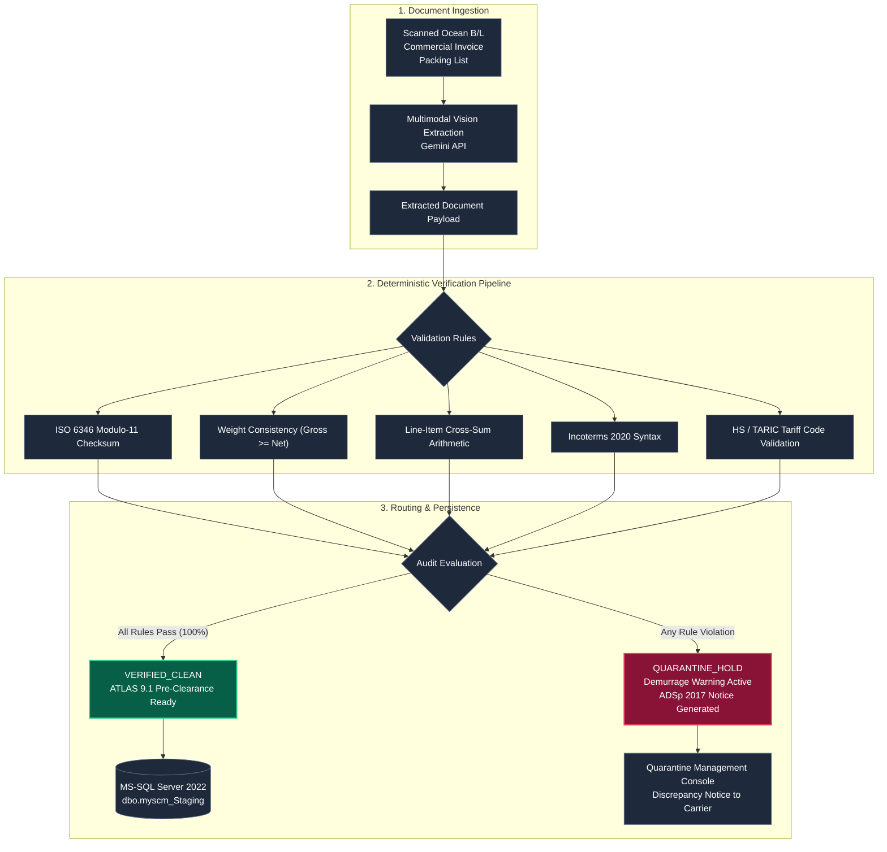

# RedLine Gateway
### Shipping Document Ingestion, Deterministic Validation & Customs Gateway

[](https://redline-gateway.onrender.com)
[](https://redline-gateway.onrender.com)
[](https://www.python.org/)
[](https://fastapi.tiangolo.com/)
[](https://www.docker.com/)
[](https://www.spediteure.de/adsp/)

> **Project Status:** Deployed portfolio system demonstrating document extraction, deterministic reconciliation, and ERP-safe staging for freight workflows.  
> **Workflow Model:** Modeled on European freight forwarding operations ([Red Line Internationale Spedition GmbH](https://www.red-line-logistics.com/) / [mw1group](https://www.mw1group.com/)).  
> **Live Interactive Service:** [https://redline-gateway.onrender.com](https://redline-gateway.onrender.com)  
> **Interactive API Docs (Swagger):** [https://redline-gateway.onrender.com/docs](https://redline-gateway.onrender.com/docs)  
> **Health Probe:** [https://redline-gateway.onrender.com/health](https://redline-gateway.onrender.com/health)

---

## 1. Overview & Systems Philosophy

In production logistics, **stochastic model outputs must never write directly to core enterprise databases**. When a vision-language model hallucinates an extra zero on a gross weight or misreads an intermodal container digit, the financial consequences are severe:
* **Terminal Gate Rejection:** Invalid container numbers fail terminal operating systems (TOS) at container hubs (Hamburg CTA/NTB, Rotterdam World Gateway).
* **Demurrage & Detention Liabilities:** Discrepancies between carrier Bills of Lading and supplier customs declarations cause terminal hold-ups costing **€150–€350 per container per day**.
* **Customs Penalties:** Submitting conflicting declarations to the German customs system (ATLAS 9.1) violates § 412 HGB (German Commercial Code) and halts clearance.

**RedLine Gateway** solves this by establishing a strict **deterministic verification barrier** between unstructured multimodal document ingestion and enterprise database staging.

```
[ Unstructured Documents ] 
        │ (PDF / Image Scans)
        ▼
[ Multimodal Vision Extraction ] (Gemini Vision API)
        │ (Structured Key-Values)
        ▼
╔══════════════════════════════════════════════════════════════════╗
║               DETERMINISTIC VERIFICATION BARRIER                 ║
║  1. ISO 6346 Modulo-11 Container Checksum Verification           ║
║  2. Physical Mass Conservation Law (Gross >= Net)                ║
║  3. 3-Way Dossier Cross-Reconciliation (B/L vs Inv vs Packing)   ║
║  4. ICC Incoterms 2020 & ISO 4217 Currency Standard Checks       ║
║  5. HS / TARIC Tariff Code Syntax Validation                     ║
╚══════════════════════════════════════════════════════════════════╝
        │                                  │
   (All Pass)                        (Any Violation)
        ▼                                  ▼
[ Staging Database ]             [ Quarantine Management ]
 MS-SQL / SQLite Staging Tables    Halts Demurrage Accrual
 Parameterized T-SQL Inserts       Generates ADSp 2017 Carrier Memo
 Verified ATLAS 9.1 Pre-Clearance
```

---

## 2. System Architecture



---

## 3. Core Deterministic Verification Modules

### 1. ISO 6346 Modulo-11 Container Checksum
Every intermodal freight container contains an 11-character identifier (4-letter owner code, 6 serial digits, 1 check digit). The check digit is calculated using a standard Modulo-11 algorithm with weighted powers of 2:

$$\text{Check Digit} = \left( \sum_{i=0}^{9} \text{Value}(c_i) \times 2^i \right) \pmod{11} \pmod{10}$$

```python
# app/services/audit.py
def calculate_iso6346_check_digit(container_code: str) -> Tuple[bool, int, str]:
    clean_code = re.sub(r'[^A-Za-z0-9]', '', container_code.upper())
    if len(clean_code) != 11:
        return False, -1, "Invalid length"
    
    total = sum((ISO_6346_LETTER_MAP[c] if c.isalpha() else int(c)) * (2 ** i) for i, c in enumerate(clean_code[:10]))
    remainder = total % 11
    calc_digit = 0 if remainder == 10 else remainder
    return (calc_digit == int(clean_code[10])), calc_digit, "Checksum verified"
```

### 2. Physical Mass Conservation Verification (§ 412 HGB)
Adheres to shipper declaration rules under Section 412 of the German Commercial Code:
* Gross weight must strictly exceed net weight ($Gross > Net$).
* Tare weight variance across documents must stay within the legal German customs threshold ($|\Delta| \le 50\text{ kg}$).
* Negative tare weights immediately trigger `QUARANTINE_HOLD`.

### 3. Three-Way Freight Triad Reconciliation
Cross-checks the core maritime documentation set before vessel docking:
* **Ocean Bill of Lading** vs. **Commercial Invoice** vs. **Packing List**
* Verifies container numbers, colli quantities, weights, currencies, and Incoterms across all three documents.
* Detects weight or item discrepancies and calculates averted demurrage costs.

### 4. Carrier Discrepancy Notice Generator (ADSp 2017)
When discrepancies are detected, the gateway automatically generates a formal legal notice citing **ADSp 2017 Section 19** and **§ 412 HGB** to notify shipping lines immediately and halt demurrage liability.

---

## 4. Failure Handling: Example Scenarios

| Scenario | Input Data | Gateway Action | Result & Safeguard |
| :--- | :--- | :--- | :--- |
| **Invalid Check Digit** | Container `MSCU7821949` declared (Actual check digit is `0`) | Catches check digit mismatch | Status `QUARANTINE_HOLD`. Prevents terminal gate-in rejection at port of discharge. |
| **Physical Law Breach** | Gross: `1,500 kg`, Net: `2,200 kg` | Detects negative tare weight | Flags `Physical Law Violation`. Blocks erroneous customs declaration submission. |
| **Weight Triad Mismatch** | B/L: `24,500 kg`, Packing List: `24,320 kg` ($\Delta = 180\text{ kg}$) | Exceeds 50 kg tolerance limit | Triggers quarantine, estimates €1,250 demurrage risk, and compiles ADSp 2017 carrier notice. |
| **Clean Freight Triad** | B/L, Invoice & Packing List align within 50 kg tolerance | 100% verification pass | Status `VERIFIED_CLEAN`. Emits parameterized T-SQL to `dbo.myscm_Staging_Shipments`. |

---

## 5. Technology Stack

| Layer | Component | Technology | Role |
| :--- | :--- | :--- | :--- |
| **API Backend** | Web Framework | FastAPI (Python 3.11) | Asynchronous REST microservice with Pydantic v2 schemas |
| **Extraction** | Document Vision | Google Gemini Vision API | Ephemeral multimodal entity extraction and key-value mapping |
| **Validation** | Rules Engine | Pure Python | Deterministic ISO 6346, arithmetic, and trade code rule validation |
| **Persistence** | Staging Database | SQLite / MS-SQL Server | SHA-256 audit ledger; parameterized T-SQL staging bridge |
| **Integration** | Client Driver | C# / .NET 8 (`RedLineGatewayClient.cs`) | Asynchronous `HttpClient` integration client |
| **Deployment** | Containerization | Docker & Render | Multi-stage Debian-slim container deployed in Frankfurt (EU-Central) |

---

## 6. Verification & Automated Test Harness

The system includes both an automated 7-suite verification test harness (`verify_all.py`) and a standard `pytest` integration test suite.

### Running Verification Tests
```bash
# Run comprehensive 7-suite verification harness
python verify_all.py

# Run standard pytest suite
pytest -v
```

### Actual Terminal Execution Receipt:
```text
======================================================================
REDLINE GATEWAY: EXHAUSTIVE AUTOMATED VERIFICATION SUITE
Red Line Spedition / mw1group Logistics Reference System
======================================================================

----------------------------------------------------------------------
SUITE 1: Configuration & Environment Settings
----------------------------------------------------------------------
[PASS] Suite 1: Configuration & Environment Settings
  [OK] COMPANY_NAME verified: 'Red Line Internationale Spedition GmbH'
  [OK] PARTNER_NAME verified: 'mw1group'
  [OK] DATABASE_URL verified: 'sqlite:///./redline_gateway.db'

----------------------------------------------------------------------
SUITE 2: ISO 6346 Container Checksum & Modulo-11 Logic
----------------------------------------------------------------------
[PASS] Suite 2: ISO 6346 Container Checksum & Modulo-11 Logic
  [OK] Valid container 'MSCU7821940' verified (Check digit: 0)
  [OK] Valid container 'MSKU2264800' verified (Check digit: 0)
  [OK] Invalid checksum 'MSCU7821949' correctly caught (Expected digit 0 != declared 9)
  [OK] Malformed container 'MSCU78219' correctly rejected: Invalid length (9 chars). Standard requires exactly 11 characters.

----------------------------------------------------------------------
SUITE 3: Deterministic Compliance & Physical Conservation Audit Rules
----------------------------------------------------------------------
[PASS] Suite 3: Deterministic Compliance & Physical Conservation Audit Rules
  [OK] Clean freight document passed audit: status='VERIFIED_CLEAN', checks=7/7
  [OK] Physical Law Violation (Gross < Net) correctly quarantined: reason='Physical Law Violation: Gross Weight < Net Weight'
  [OK] Missing shipper/consignee correctly flagged with ATLAS clearance block

----------------------------------------------------------------------
SUITE 4: 3-Way Freight Triad Reconciliation & ADSp 2017 Discrepancy Notices
----------------------------------------------------------------------
[PASS] Suite 4: 3-Way Freight Triad Reconciliation & ADSp 2017 Discrepancy Notices
  [OK] 180 kg variance correctly flagged: status='DISCREPANCY_FLAGGED', prevented_demurrage=€1,250.00
  [OK] ADSp 2017 / § 412 HGB discrepancy notice generated for carrier notification

----------------------------------------------------------------------
SUITE 5: T-SQL ERP Staging & C# Client Driver Generation
----------------------------------------------------------------------
[PASS] Suite 5: T-SQL ERP Staging & C# Client Driver Generation
  [OK] MS-SQL DDL script verified: targets '[dbo].[myscm_Staging_Shipments]'
  [OK] Parameterized T-SQL INSERT statement safely escaped and verified
  [OK] C# .NET 8 async client snippet verified: class 'RedLineGatewayClient'

----------------------------------------------------------------------
SUITE 6: FastAPI HTTP Endpoints (Live Test Client)
----------------------------------------------------------------------
[PASS] Suite 6: FastAPI HTTP Endpoints (Live Test Client)
  [OK] GET /health: 200 OK (Status='online')
  [OK] GET /: 200 OK (Dashboard HTML loaded)
  [OK] GET /api/v1/metrics: 200 OK (Operational metrics returned)
  [OK] GET /api/v1/integration/mssql-ddl: 200 OK
  [OK] GET /api/v1/reconcile-samples: 200 OK (Freight triad samples available)

----------------------------------------------------------------------
SUITE 7: SHA-256 Cryptographic Audit Ledger Integrity
----------------------------------------------------------------------
[PASS] Suite 7: SHA-256 Cryptographic Audit Ledger Integrity
  [OK] SHA-256 digest computation verified: e7b12cbb6920538d... (64 hex chars)
  [OK] Tamper evidence confirmed: 1-byte alteration yields completely divergent digest (avalanche effect)

======================================================================
FINAL VERIFICATION SUMMARY
======================================================================
Suite 1: Configuration & Environment Settings                         [PASS]
Suite 2: ISO 6346 Container Checksum & Modulo-11 Logic                [PASS]
Suite 3: Deterministic Compliance & Physical Conservation Audit Rules [PASS]
Suite 4: 3-Way Freight Triad Reconciliation & ADSp 2017 Discrepancy Notices [PASS]
Suite 5: T-SQL ERP Staging & C# Client Driver Generation              [PASS]
Suite 6: FastAPI HTTP Endpoints (Live Test Client)                    [PASS]
Suite 7: SHA-256 Cryptographic Audit Ledger Integrity                 [PASS]
======================================================================
ALL 7 SUITES PASSED: SYSTEM VERIFIED DEPLOYABLE & RELIABLE.
```

---

## 7. ERP Staging Pattern & Integration Specs

### Decoupled Staging Schema (`[dbo].[myscm_Staging_Shipments]`)
```sql
CREATE TABLE [dbo].[myscm_Staging_Shipments] (
    [StagingID] INT IDENTITY(1,1) PRIMARY KEY,
    [ShipmentRef] NVARCHAR(50) NOT NULL,
    [ContainerNumber] NVARCHAR(11) NULL,
    [SealNumber] NVARCHAR(30) NULL,
    [GrossWeightKg] DECIMAL(10,2) NULL,
    [NetWeightKg] DECIMAL(10,2) NULL,
    [TotalPackages] INT NULL,
    [PackageType] NVARCHAR(50) NULL,
    [InvoiceTotal] DECIMAL(12,2) NULL,
    [CurrencyCode] CHAR(3) DEFAULT 'EUR',
    [Incoterm] CHAR(3) NULL,
    [OriginPort] NVARCHAR(50) NULL,
    [DestinationPort] NVARCHAR(50) NULL,
    [ShipperName] NVARCHAR(200) NULL,
    [ConsigneeName] NVARCHAR(200) NULL,
    [AuditStatus] NVARCHAR(30) NOT NULL,
    [AtlasReady] BIT DEFAULT 0,
    [IngestedAtUtc] DATETIME2 DEFAULT SYSUTCDATETIME()
);

CREATE INDEX IX_Staging_Container ON [dbo].[myscm_Staging_Shipments] ([ContainerNumber]);
CREATE INDEX IX_Staging_Status ON [dbo].[myscm_Staging_Shipments] ([AuditStatus]);
```

### C# / .NET 8 Async Ingestion Client
```csharp
using System.Net.Http.Json;

public class RedLineGatewayClient
{
    private readonly HttpClient _client;

    public RedLineGatewayClient(string apiUrl = "https://redline-gateway.onrender.com")
    {
        _client = new HttpClient { BaseAddress = new Uri(apiUrl) };
    }

    public async Task<RedLineStagingResponse> IngestFreightDocumentAsync(byte[] documentBytes, string fileName)
    {
        using var content = new MultipartFormDataContent();
        content.Add(new ByteArrayContent(documentBytes), "file", fileName);

        var response = await _client.PostAsync("/api/v1/documents/process", content);
        response.EnsureSuccessStatusCode();

        return await response.Content.ReadFromJsonAsync<RedLineStagingResponse>();
    }
}
```

---

## 8. Local Setup

### Step 1: Clone Repository
```bash
git clone https://github.com/AllenFletcherAI/Redline-Gateway.git
cd Redline-Gateway
```

### Step 2: Install Dependencies
```bash
pip install -r requirements.txt
```

### Step 3: Configure Environment
Create a `.env` file in the root folder:
```env
GEMINI_API_KEY="your-google-gemini-api-key"
PORT=8000
HOST=0.0.0.0
COMPANY_NAME="Red Line Internationale Spedition GmbH"
PARTNER_NAME="mw1group"
```

### Step 4: Run Application
```bash
python run.py
```
* **Web UI:** `http://localhost:8000`
* **Swagger API Docs:** `http://localhost:8000/docs`
* **Health Check:** `http://localhost:8000/health`

---

## 9. Data Integrity & Security Controls

* **Audit Trail (GoBD §§ 146, 147 AO):** Ingested documents receive a SHA-256 cryptographic digest binding file content, timestamp, and audit results into an immutable audit ledger.
* **Privacy & Data Minimization (GDPR / DSGVO):** Document payloads are processed ephemerally in memory. Ingestion endpoints are configured with zero third-party retention for machine learning model training.
* **Least-Privilege Execution:** The production Docker container runs under an unprivileged user (`gateway`, UID `1000`) following container hardening practices.

---

## 10. License & Reference Project Notice

This software is an independent portfolio and reference architecture system modeled on freight forwarding processes. Released under the [MIT License](LICENSE).
